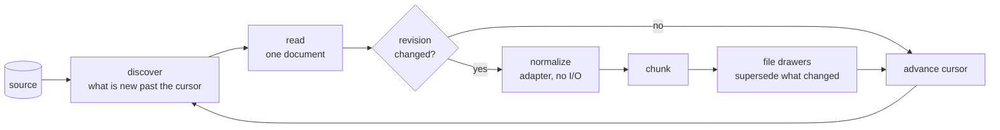

# Mining sources

A source module inside an installed [provider plugin](plugins.md) appears in this list with origin `plugin`.
Installing the parent plugin leaves that source in `installed` state until `memcastle source enable <name>` is requested.
Different modules in one provider still keep separate source identities, miner configuration and ingestion cursors.

MemCastle can fill the palace itself, without an agent writing anything and without spending a model's tokens.
Mining reads a **source**, such as a directory or an agent's session history, and files what it finds as drawers.
This page is the model behind it and the reference for the sources MemCastle ships.
The reasoning is in [ADR-023](adr/023-unified-source-model-for-mining.md).

Memory reaches the palace two ways.
**Agent-driven** memory is what an agent writes through MCP (a [checkpoint](mcp-and-api.md#checkpoint-payload), a diary
entry).
**Source-driven** memory is what MemCastle acquires on its own: `memcastle mine` reads a source and no agent is involved.
Both end as drawers, and search does not tell them apart except by `source_kind`.

## How a source is mined



Everything left of "chunk" is the **adapter's** job and is specific to the source.
Everything from "chunk" on, and the loop itself, is the same for every source.

| Stage | Done by | What it does |
|---|---|---|
| discover | adapter | Lists documents after the source's cursor, cheaply and in order. |
| read | adapter | Acquires one document as the source provides it. No model, no agent. |
| normalize | adapter | Expresses it in MemCastle's terms: title, room, name, text segments. Pure. |
| chunk and file | MemCastle | Cuts it into drawer-sized chunks, skips what is unchanged, supersedes what changed. |
| enrich | the `extract` job | Reads what was filed and adds entities and relationships to the knowledge graph; it never rewrites a drawer. |

### Entities and relationships

Mining files drawers and stops.
When an [extraction provider](configuration.md#extraction) is configured, the daemon then queues an `extract` job that reads
the drawers mining filed and adds the entities and relationships they name to the knowledge graph.
It is a separate job on purpose: the pipeline above does not know it exists, no adapter takes part, and a slow or failing
model cannot hold up a mining cursor.
Each fact records the source, document, chunk and revision it was read from, so it can be traced to the drawer that is its
evidence and stops being current when that drawer is replaced.
Any source that mines through the model above is covered, because extraction reads drawers, not sources.
Names that differ only in spelling across documents converge on one entity, and each mention keeps the spelling its
document used.
See [ADR-024](adr/024-entity-extraction-as-an-enrich-job.md) and [Deduplication](deduplication.md).

### Duplicates across documents

Two documents with the same text are two documents, so mining stores both.
After storing a chunk, though, it notes what the chunk resembles among the drawers already in its room: an identical or
nearly identical chunk gets a `similar_to` link with the evidence, and the job's result counts these as `similar`.
Nothing is skipped or merged, and the pipeline learns nothing about sources from it.
See [Deduplication](deduplication.md).

### Identity, cursor and documents

A source is identified by `(source, account, locator)`: the adapter's name, the account on it if it has accounts, and the
part of it that is read (a directory, a sessions folder, a channel).
Two jobs that name the same place share one source, and therefore one cursor.

MemCastle keeps, for each source:

- the **cursor**: where the last run stopped, in the adapter's own terms.
  A later job continues from it, which is what makes mining incremental;
- the **last job** that advanced it and when;
- a **credential reference**, if the source needs one: the name of an environment variable, the path of a file, or
  `oauth` for a source that signs in with OAuth and whose tokens the daemon keeps and renews
  ([Credentials](configuration.md#credentials)).
  A secret is never stored, logged or returned, see [Authentication](authentication.md);

and for each document of a source, the **revision** last filed and the **chunks** it became.
Each mined drawer also snapshots that revision's source metadata and event time in its origin.
This lets [source preferences](configuration.md#source-preferences) match connector-specific metadata without changing
how the source identifies itself, and keeps an older drawer's preference criteria explainable after a re-mine.

### What "incremental" and "idempotent" mean here

- A re-mine of an unchanged incremental source reads nothing: the cursor is past everything.
  A non-incremental source such as `chatgpt` rescans and skips documents whose content hash has not changed.
- If the cursor is lost or you pass `--full`, everything is read again, and an unchanged document is recognised by its
  revision and skipped.
  Nothing is duplicated either way, so the cursor is a speed-up, not something correctness depends on.
- An edited document keeps the drawers whose text did not change and **supersedes** the ones that did.
  If its metadata changes, the affected chunks are superseded even when their text is the same, to retain the
  revision-specific evidence context.
  The old text stays as history (`valid_to`), and a search for "as of" an earlier date still finds it.
  Appending to a transcript changes only its last chunk.
- A document that got shorter closes the chunks past its new end, so stale text is not searchable as if it were current.
- A document that vanished from the source is not noticed: deletions are not propagated.
- A job that is paused, interrupted or crashed resumes from its own checkpoint and files nothing twice.

### Chunking

A document that fits in `mining.chunk_chars` characters (6000 by default) is **one drawer, verbatim**.
A longer one is cut into several:
whole units the adapter delimited (a message, say) are packed together up to the size, and a unit larger than a chunk is
cut at a paragraph break, else a line break, else mid-line.
Only the first drawer of a document carries its name.
Sizes count characters, so a cut never lands inside a character.

### Limits

By default jobs are unlimited (`mining.max_documents = 0`) but discover in bounded pages and checkpoint every document.
Set a positive `mining.max_documents` to limit every job, or a positive `max_documents` on one miner to override it.
If the source has more, the job completes with `"truncated": true`, its progress message says to run it again, and the
next job continues from the cursor.

## Using it

```sh
memcastle sources                        # what can be mined, and what has been
memcastle mine ~/project                 # a directory (the shorthand for `memcastle mine directory ~/project`)
memcastle mine pi                        # Pi session history, from its default location (once installed, below)
memcastle mine pi /backups/pi/sessions
memcastle mine pi dir=/work/app --full
memcastle mine opencode since=2026-09 dir=/path/to/workspace   # OpenCode session history (once installed)
memcastle mine claude since=2026-09 dir=/path/to/workspace     # Claude Code session history (once installed)
memcastle mine codex                                           # Codex rollout history (once installed)
memcastle mine chatgpt /path/to/chatgpt-export.zip            # ChatGPT data export (once installed)
memcastle mine github include=acme/docs wiki_include=acme/docs # selected GitHub repository and wiki history
```

An existing configured miner ID takes precedence over a same-named source; otherwise the first word is a source,
and what follows is that source's own: at most one place to read, then `key=value` options
that the source declares (`memcastle sources` lists them; an unknown key is refused before anything is queued).
A word that is not shaped like a source name (`.`, `~/project`, `./pi`) is a directory.
See [`mine`](cli.md#mine) for the whole grammar.

`memcastle sources` (`GET /api/sources`) lists the adapters (built in and installed, with their state), then each source
that has been mined with its document count, last job and last run.
Over HTTP, a source job is `{"type": "mine", "source": "pi", "locator": "...", "options": {"since": "2026-09"},
"full": false}`
on `POST /api/jobs`, and over MCP `memcastle_mine` takes `source`, `locator`, `options` and `full` beside `path` and `wing`.
The command line's grammar is only a way to type that request: the daemon, REST and MCP take the resolved source,
place and options.
Mining is a write, so a [read-only or disabled session](memory-modes.md) cannot start it.

### Remembering what to mine

`memcastle mine` names a source and where to read every time.
A **miner** is a named definition, kept as `[[miners]]` or a file under the miners directory:
a source (or named source configuration), locator, saved options, destination, limit and optional schedule
([Configuration](configuration.md#miners), [`memcastle miner`](cli.md#miner)).
`memcastle miner run <name>` submits the same job `mine` would, with the miner's saved options,
so a miner continues from the cursor its source already has.
The cursor belongs to the effective source identity (adapter/account/locator and, when needed, source configuration and
destination mapping), not the miner's name.
Renaming, disabling or removing a miner never deletes what it mined; changing a mapping can select an independent cursor.
Each durable mining job pins its resolved `kind.preset` (miner, source configuration, mapping and limit).
Drawers retain their job ID and source item origin, so the producing preset can be recovered without storing credentials
or rewriting historical drawers.
An agent can read the miners (`memcastle_miner_list`, `memcastle_miner_get`) but only the user changes them.

A miner runs when asked.
Its optional timetable remains off until explicitly enabled with `miner schedule-enable`.
To have it run on its own (daily, when files change, when a service calls a webhook) the user defines a
[trigger](triggers.md) for it, which starts disabled and which no source, install or miner ever enables.
The trigger only decides when; the source still decides how to read.

The job's `result` reports `documents`, `discovered`, `filtered`, `ingested`, `created`, `superseded`, `retired`,
`unchanged`, `skipped`, `similar`, `truncated` and the effective `limit` (`null` when unlimited).
A fatal discovery/read error fails the job before advancing past the failed item; adapter-filtered items are excluded from
`discovered`, and the source reports a skipped candidate separately when it cannot read it.
The directory adapter reports an exact `filtered` count for include/exclude/date exclusions;
an installed source currently reports zero unless its contract offers such a count.

## Available sources

| Source | Kind | Reads | Cursor | Keeps raw | Credentials |
|---|---|---|---|---|---|
| `directory` | built in | the text files under a directory | modification time | no | no |
| `pi` | external `memcastle-pi` plugin | Pi coding-agent session history | modification time | yes | no |
| `opencode` | external `memcastle-opencode` plugin | OpenCode coding-agent session history | `time_updated` of the session | yes | no |
| `claude` | external `memcastle-anthropic` plugin | Claude Code session history | modification time | yes | no |
| `github` | external `memcastle-github` plugin | selected repositories, issues, PRs and wiki revisions | API updates / Git history | yes | optional `GH_TOKEN` or `GITHUB_TOKEN` |
| `codex` | external `memcastle-openai` plugin | Codex rollout history | modification time | yes | no |
| `chatgpt` | external `memcastle-openai` plugin | ChatGPT export or experimental web history | repeated sweep | yes | OAuth for web, optional manual fallback |

Only `directory` is compiled into MemCastle.
`pi`, `opencode`, `claude`, `codex`, `chatgpt` and `github` are [WebAssembly sources](writing-sources.md).
The `sources/` directory contains a reference WebAssembly implementation; Core currently bundles no WebAssembly sources.
Install the external Pi, OpenCode, Anthropic, GitHub or OpenAI plugin before enabling its source.
No Pi, OpenCode, Claude Code, Codex, ChatGPT or GitHub acquisition code is part of the core.
They run under the same sandbox and pipeline as any source a user writes.
Other sources are found in [registries](publishing-sources.md).
`directory` and `pi` have a modification-time watermark as their cursor:
files are ordered by modification time, then by path, and the cursor is the last one done.
A file that appears with an old modification time (restored from a backup, copied with its times preserved) is behind the
watermark and is picked up by `--full`.

### `directory`

One document per file, identified by its path under the mined root, filed in the room `files` of the wing you give
(default: the wing the directory's [project file](project-config.md#mining) declares, else the directory's name)
and named by that path, so `wing/files/src/lib.rs` addresses it.

- It skips directories named `.git`, `target`, `node_modules`, `.venv`, `venv`, `dist`, `build` and `.cache`, at any depth,
  along with any other directory whose name starts with `.` and any symlink.
- It skips empty files, files larger than `mining.max_file_bytes` (2 MiB by default) and files that are not valid UTF-8.
- `source.kind` is `file` and `source.uri` is the file's absolute path.

### `pi`

The conversation history of the [Pi](https://github.com/badlogic/pi-mono) coding agent, read straight from its session
files: `~/.pi/agent/sessions/<working directory>/<session>.jsonl`,
or the folder you name as the place to read (`memcastle mine pi <folder>`).
It works on sessions of any age and with no Pi process running.
This is how Pi's *history* gets into MemCastle.
The live integration (also in `memcastle-pi`) is a separate module that talks to the daemon over MCP, decides *when* to
ask for mining and never reads these files itself.

Install the standalone plugin first, then turn on the source and mine it:

```sh
memcastle plugin install /path/to/pi-0.1.0.tar.gz --consent pi=SHA256_FROM_PREVIEW
memcastle source enable pi
memcastle mine pi
```

Add `--adopt-source pi` only if the preview reports previously mined `pi` history from a Core-bundled or legacy source.
Remove a separately installed legacy `pi` package first (`memcastle source remove pi`); its mined data stays in the palace.
The installation preview shows the exact permissions and consent digest to provide with the install command.
Until an independent release exists, build the archive in the `memcastle-pi` checkout with `mise run package`.

Installing the plugin lists what the source asks for and needs your consent to exactly that;
`memcastle source show pi` lists the installed source's permissions afterward.
It asks for read-only access to the folder it is asked to mine and to `~/.pi/agent/sessions`,
and the one environment variable `HOME` (to find that folder when no place is given).
It asks for no network, runs no program, writes no file and needs no credentials.
`memcastle source test modules/pi` runs its conformance cases from the external checkout.

Two options narrow what is read.
`since=2026-09` keeps the sessions whose file was modified at or after the date,
and `dir=/work/app` keeps the sessions that
were started in that working directory (read from each session's header).
A `dir` may be a pattern: `*` matches any run of characters, `/` included,
so `'dir=/work/*'` is every working directory under `/work`.
The path is cleaned up the way Pi records it, so a trailing slash, a `.` or a `..` makes no difference, and
`memcastle mine` resolves links in the part that exists before it reaches the daemon.
A session file with no readable header has no directory, so a `dir` never selects it.
`dir` is part of the source's identity, so every directory has a cursor of its own;
`since` only narrows and shares the source's cursor.

Each session is one document, identified by its path under the sessions folder (`<working directory>/<session file>`),
filed in the wing `pi` (or the one you give), in a room named after the session's working directory, and named by its
file, so it can be addressed as `pi/<project>/<session file>`.
Drawers have `source.kind` `transcript` and the tags `transcript` and `pi`.
Provenance is the session itself: `source.uri` is the session file's path, the document's metadata carries the session
id, working directory and format version from its header, and the document's time is when the session started (the
header's timestamp), not when its file was last written.

What is filed: a header (session id and working directory), then each user and assistant message as text with the time
it was written.
Tool calls are kept as one-line markers (`[tool call: read]`) and shell commands the user ran as `[bash: ...]`.
What is deliberately left out: model reasoning, tool results (large, and usually file contents that can be mined as files)
and everything that is not a conversation message.
A line that is not JSON or an entry type the reader does not know is skipped, not an error.
The reader follows Pi's session format version 3 and only lists `*.jsonl` files, directly in the sessions folder or one
folder down, so it never opens anything else under Pi's directory, in particular not its credentials file, and it does not
follow symlinks.
The raw session file is kept next to the drawers, because Pi's sessions are the user's to rotate away.
Mining is incremental and idempotent: a session that has not changed is not read again, and one that grew files only its
new tail.

### `claude`

The conversation history of [Claude Code](https://docs.anthropic.com/en/docs/claude-code), read straight from its
per-session JSONL transcripts under `~/.claude/projects/<project>/<session>.jsonl`, or from a projects folder named as the
locator.
It works on sessions of any age and with no Claude Code process running.
It is history mining only: it does not read Claude Code settings, credentials, prompt history or debug logs, and it is not
the live Claude Code MCP client.

Install the independently released Anthropic plugin, then enable the source:

```sh
memcastle plugin install anthropic
memcastle source enable claude
memcastle mine claude
```

A previously mined `claude` source retains its cursor and drawers after removing its old package record.
After moving off the old Core bundle, preview the Anthropic archive and use `memcastle plugin install` with
`--adopt-source claude` and the requested consent digest before enabling it again.
The source identity and the `since`/`dir` option names are unchanged.
For local plugin development, install the built archive rather than a Core source directory:

```sh
memcastle plugin install /path/to/memcastle-anthropic/dist/anthropic-0.1.0.tar.gz
memcastle source enable claude
```

It asks for read-only access to the locator and `~/.claude/projects`, and `HOME` only to find the latter when no locator
is given.
It asks for no network, process, write or credential permission.
The reader lists only `.jsonl` files exactly one project directory below that root and does not follow symlinks.

Each session is one `transcript` document, identified by its path under the projects root, filed in wing `claude` and
in a room named after its recorded working directory.
It has the `transcript` and `claude` tags; provenance is the transcript file and its recorded session id, working directory
and start timestamp when present.
The source keeps ordered user and assistant text plus compact tool-use markers such as `[tool: Read]`.
It deliberately excludes thinking, tool results and output, system and compaction records, attachments, patches, malformed
lines and unknown record kinds.
A transcript with no retained message becomes no segments.

`since=2026-09` narrows to files modified at or after that date; `dir=/work/app` narrows to the recorded working directory,
and accepts the same `*` patterns as `pi`.
`dir` is a separate source identity and cursor; `since` only narrows the current source.
Files are ordered by modification time and path, so an appended transcript is discovered again without skipping a tie.
Earlier message segments stay byte-identical when a session gains a tail.

The source declares `watch`, but that is only a capability.
It never creates a miner or enables a trigger:

```toml
[[miners]]
name = "claude-history"
source = "claude"
locator = "/home/alice/.claude/projects"

[[triggers]]
name = "claude-history-watch"
miner = "claude-history"
type = "watch"
enabled = false
path = "/home/alice/.claude/projects"
debounce = "5s"
```

Enable the trigger only after reviewing the locator and source permissions.
Without a trigger, `memcastle miner run claude-history` is the manual fallback.

### `opencode`

The conversation history of the [OpenCode](https://opencode.ai) coding agent, acquired by asking OpenCode for it.
OpenCode keeps every session in one SQLite database that it writes while it runs, so this source does not open that
file: it runs the `opencode` command, which owns the database, and turns its answers into documents.
It works on sessions of any age and with no OpenCode session running, calls no model and replays nothing.
This is how OpenCode's *history* gets into MemCastle; its agent integration is a separate module in the same plugin.
It talks to the daemon over MCP and decides *when* to ask for mining.
The [memcastle-opencode](https://github.com/memcastle/memcastle-opencode) repository owns both modules.

It needs OpenCode 1.2 or later (the version that moved history into the database) installed so that `opencode` is on the
daemon's `PATH`; it was written against 1.18.
Build the archive from that repository until an independent release is available, then install it with the permission
digest reported by its preview; previously mined legacy history also needs `--adopt-source opencode`:

```sh
memcastle plugin install /path/to/opencode-0.1.0.tar.gz --consent opencode=SHA256_FROM_PREVIEW
memcastle source enable opencode
memcastle mine opencode
```

The plugin preview lists what the source asks for and needs your consent to exactly that;
`memcastle source show opencode` lists the same after installation.
It asks for running the program `opencode`, and the environment variable `XDG_DATA_HOME`
(OpenCode reads it to find its data when you have moved it; `PATH` and `HOME` are always passed to a program).
It asks for no file access, no network, and needs no credentials.
A program is a wider grant than a file: `opencode` runs with the daemon's own authority over the machine,
and the sandbox only decides *which program*, not what that program does.
That is the reason the grant is one named program, with no shell, and the reason installing asks you to agree to it.
The provider's conformance suite runs against a stand-in `opencode` in
`memcastle-opencode/modules/opencode/fixtures/bin/`, first on the `PATH`.

Each session is one document, identified by its OpenCode session id (`ses_...`), filed in the wing `opencode`
(or the one you give), in a room named after the session's working directory, and named by its id,
so it can be addressed as `opencode/<project>/<session id>`.
Drawers have `source.kind` `transcript` and the tags `transcript` and `opencode`.
Provenance is the session itself: `source.uri` is `opencode://session/<id>`, the document's metadata carries the session
id, project id, working directory, title and OpenCode version, and the document's time is when the session was created.

What is filed: a header (session id and working directory), then each user and assistant message as text with the time it
was written.
Tool calls are kept as one-line markers (`[tool: read] scripts/rotate.sh`) and attached files as their names
(`[file: TODO.md]`).
What is deliberately left out: model reasoning, tool outputs (large, and usually file contents that can be mined as
files), patches and snapshots, text OpenCode injected itself (parts it marks `synthetic` or `ignored`), the summaries it
writes when it compacts a session, and file contents.
A part type the reader does not know is skipped, not an error.

Mining is incremental and idempotent.
Discovery asks `opencode db` for the sessions whose `time_updated` is past the cursor, in order, so a session OpenCode
has written to since is read again and one that has not is not.
A session that grew files only its new tail, and renaming a session changes none of what is already filed.
A session with no messages is skipped, and is read again when it gets some.
The place to read (`memcastle mine opencode <name>`) is only a name for the history being mined; without one,
the source is
identified by the database path `opencode db path` prints,
so a moved `XDG_DATA_HOME` is a different source with a cursor of its own.

Two options narrow what is read.
`since=2026-09` keeps the sessions whose `time_updated` is at or after the date,
and `dir=/path/to/workspace` keeps the sessions
whose recorded project directory is that path, or matches it when it holds a `*` (any run of characters, `/` included:
`'dir=/work/*'` is every project under `/work`).
Both sides are compared without a trailing slash and with `.` and `..` resolved, so how the path is spelled makes no difference.
Quote a pattern in a shell, which would otherwise expand the star itself.
`dir` selects a different slice of the history,
so it is part of the source's identity and every directory has a cursor of its own;
`since` only narrows, so it shares the cursor of the unfiltered source (`--full` reads back past it).

Limits to know about:

- **One query depends on OpenCode's internals.**
  `opencode session list` cannot ask for only what changed, so discovery reads the `id` and `time_updated` columns of
  OpenCode's `session` table through `opencode db`.
  If a future OpenCode renames them, the job fails with OpenCode's own message and nothing is filed wrongly.
- **A session whose export exceeds 16 MiB is skipped.**
  A program's output is capped at that size for every source, and a session that large is usually one whose tool outputs
  dominate; it is not an error, so it does not stop the sessions after it.
- **A command's output is captured through files, not pipes.**
  OpenCode can exit before a large answer has drained from a pipe, which cuts it off while the exit status is still 0.
  The host therefore has the program write to a scratch file it reads back, so a long list of sessions or a large export
  arrives whole.
  If a discovery answer is still not valid JSON, the job's error quotes how many bytes arrived and how they began.
- **Each command takes a few seconds on a large database**, and a job's calls are limited to 60 seconds each
  (`mining.source_timeout_secs`).
- **The legacy JSON history** that OpenCode wrote before 1.2 under `storage/` is not read.

### `codex`

The [Codex](https://developers.openai.com/codex) history source reads the dated JSONL rollout files under
`~/.codex/sessions/YYYY/MM/DD/`, or a sessions directory named as its locator.
It is separate from the Codex integration: this source acquires old and inactive transcripts, while the integration only
decides when a live Codex session uses MCP.

The [`memcastle-openai`](https://github.com/memcastle/memcastle-openai) plugin supplies this source and the separate
Codex integration.
Build its archive from the provider checkout until a release is available, then review its two source consent digests:

```sh
memcastle plugin install /path/to/openai-0.1.0.tar.gz \
  --consent codex=CODEX_DIGEST --consent chatgpt=CHATGPT_DIGEST
memcastle source enable codex
memcastle mine codex
```

After upgrading from a Core release that bundled `codex`, run `memcastle source remove codex` before plugin installation
to clear the old enabled-state row; this does not erase mined history or miner definitions.
If the preview reports historic mined `codex` data, pass `--adopt-source codex` after reviewing it.
Keep the same locator and miner configuration so the existing cursor and documents remain associated with the source.

The source reads only files named `rollout-*.jsonl` at the documented date depth, never `history.jsonl` or another file
under `~/.codex`.
It asks only for read access to that sessions directory and `HOME` to locate it when no locator is supplied.
It needs no network, process, write, or credential permission.

Each rollout is a transcript document in the `codex` wing and a room named after its recorded working directory.
The cursor is its modification time and path, and the revision is a hash of the full JSONL file, so an unchanged rollout
is not read twice and an appended rollout preserves the chunks made from its unchanged prefix.
It files user and assistant text and concise tool-call markers.
It deliberately excludes model reasoning, tool output, command and file contents, injected context, and record types it
does not understand.

### `chatgpt`

ChatGPT conversation history is imported from an official export ZIP with a top-level `conversations.json`.
A standalone `conversations.json` extracted from it is accepted too.
Install the `memcastle-openai` archive as above, then enable the source and provide the export path on the
**daemon's** machine:

```sh
memcastle source enable chatgpt
memcastle mine chatgpt /path/to/chatgpt-export.zip
```

After upgrading from a Core release that bundled `chatgpt`, run `memcastle source remove chatgpt` before installing the
plugin. This keeps mined history and cursors but removes the old enabled state and OAuth credential;
sign in again with `memcastle source auth chatgpt` before web mining.
Add `--adopt-source chatgpt` to the plugin install command if the preview reports previously mined ChatGPT data;
keep the export locator, account label and project filters unchanged to continue from its existing identity.

The export path is the source's identity.
Replacing the file at that path with a newer export and mining again revisits each conversation without duplicating
unchanged drawers; a different file path starts a separate source.
One conversation is one transcript document in `chatgpt/conversations`, identified by the conversation ID, with source
metadata, parent/child branches, assistant model information, attachment/reference descriptors and timestamps retained
in the raw document when present.
User and assistant text is searchable, including alternate branches; non-text attachments are not downloaded.
An absent conversation ID or message collection fails with an actionable error; unsupported non-text content stays in
the raw document and is not searchable.
The source permits up to 128 MiB of JSON and 16 MiB per conversation; split larger exports before importing.
Exports and raw retained documents contain private conversations.

An **experimental** alternative uses the undocumented ChatGPT web API:

```sh
memcastle source auth chatgpt
memcastle mine chatgpt
```

The sole signed-in web account is selected automatically; named ChatGPT web accounts are not yet supported.
An explicit legacy `account` label retains the corresponding cursor but is not needed for a new run.
Without a project filter, the web backend combines ordinary conversations and the full paginated history of each
project, including archived projects; the sidebar's preview alone is never treated as complete history.
`projects=id:PROJECT_ID` or `projects=name:Exact Name` selects one project; comma-separated selectors choose several.
Names must be unique and exact, and an ID is the stable choice for a scheduled miner because renames or reused names
change what the name selects.
A project selection has its own cursor, separate from the account's unfiltered history.
Export files cannot be project-filtered until their project membership is verified.
Configure the filter persistently with `memcastle miner set` and an `--option 'projects=name:Exact Name'` flag
([Configuration](configuration.md#chatgpt-project-miner)).
The daemon needs `curl`; run `memcastle source auth chatgpt` on its machine before web mining.
The daemon keeps and renews the OAuth credential, and the source asks for a current bearer through the host function.
Fresh desktop-compatible OAuth access and renewed tokens read conversation and project history **without cookies** when
the request uses a browser-style User-Agent; plain curl received a 403 edge challenge with the same token.
OpenAI's documented third-party sign-in does not grant history access, so this private desktop-compatible integration
can change independently of the generic MemCastle OAuth mechanism.
The previous fallback still accepts `MEMCASTLE_CHATGPT_BEARER` (and an optional `MEMCASTLE_CHATGPT_COOKIE`) from the daemon
environment; no session value belongs in a mine option or config setting.
It revisits conversations on every run and fails on incomplete message pages rather than filing a partial transcript.
This backend is tested against synthetic replies, not yet against a fresh live session; endpoints, login requirements and
pagination may change.
See [the source README](https://github.com/memcastle/memcastle-openai/tree/main/modules/chatgpt) for its session setup and
limits.

### `github`

Install the `memcastle-github` plugin with `memcastle plugin install github`, then enable its source explicitly with
`memcastle source enable github`.
To upgrade an enabled bundled `github` source, first upgrade Core so it no longer ships that bundle, check whether the
source was enabled, and run `memcastle source remove github --yes` to remove its old source-package record.
Removal preserves mined history and cursors; the plugin installer refuses the old record until it is removed.
Install with `memcastle plugin install github --adopt-source github` if the old source mined data, review the new
permissions, and re-enable it if it was enabled before the upgrade.
The adoption flag explicitly authorizes reuse of existing `github` data; it is unnecessary if the source never mined.
It mines only repositories selected by the required `include` option, with `exclude` taking precedence.
An exact `owner/repo` names one repository; `org/*` enumerates repositories owned by that organization, and
`owner/repo-*` selects a subset of an owner's repositories.
The separate `wiki_include` and `wiki_exclude` patterns select wikis only within those repositories.
Set `issues=false pulls=false metadata=false wiki_include=acme/docs` for a wiki-only mine.

The default document kinds are repository metadata, issues and pull requests.
Turn on `comments=true` to include conversation comments and `reviews=true` for review summaries and inline comments.
`labels` narrows issues and PRs, `topics` narrows repositories, `paths` narrows wiki pages, and `since` is a bootstrap date.
Changing a selecting pattern creates a new source cursor; moving `since` earlier requires `--full`.
Git wiki history is not exposed through the REST API: the source clones each selected wiki transiently and files each
changed Markdown page/commit as a separate document, with page path, commit and repository provenance.
The wiki revision's URL points at the page in the repository wiki; the commit ID is also kept in its metadata.

The daemon needs `curl` for the official REST API, `git` for wikis, a writable `/tmp` for temporary clones, and `rm` to
clean them up.
`GH_TOKEN` or `GITHUB_TOKEN` (in that order) can be set in the daemon's environment for private repositories or higher
rate limits; no token belongs in the miner options or `memcastle.toml`.
Public repositories can be read without a token.
The manifest grants the two variable names and the three programs, not a general filesystem or WASI network grant.
For an opt-in [poll or schedule trigger](triggers.md), point it at a GitHub miner; the trigger only requests a normal run.
See the [GitHub source README](https://github.com/memcastle/memcastle-github/tree/main/modules/github) for full scope examples
and acquisition limits.

## Writing a source

There are two ways to add a source.

- **A package** is a WebAssembly component the user installs, in any language that produces one.
  This is the extension model: the core compiles no source-specific code, and a source can be written, shipped and
  updated without a MemCastle release.
  [Writing a mining source](writing-sources.md) is the guide (the contract, the manifest, permissions, lifecycle,
  conformance, packaging), and `memcastle-source.tpl` scaffolds one through GitTPL.
- **A built-in adapter** is Rust compiled into MemCastle, for the few sources that are simpler or faster native.

Both implement the same contract, and a source cannot tell which kind it is.
The contract is `mining::adapter::SourceAdapter`, one file under `src/mining/adapters/` for a built-in:

| Method | Contract |
|---|---|
| `name`, `description`, `capabilities` | The name users give, one line about it, and whether it is incremental, keeps raw documents and needs credentials. |
| `identify(locator)` | Validate the locator and return the source's identity. Make equivalent spellings identical (a canonical path), so they share a cursor. |
| `default_wing`, `default_room` | Where drawers go when nobody chose. |
| `discover(source, cursor, limit)` | Candidates strictly after the cursor, in cursor order, at most `limit`, each with the cursor to store once it is done; and whether anything is left. Cheap: a listing. |
| `read(source, candidate)` | One `RawDocument` with a **revision** that changes exactly when the content does, or `None` to skip. |
| `normalize(raw)` | A `CanonicalDocument`. Pure: no I/O, so it is testable from fixtures. |

A built-in adapter also needs a variant in `mining::registry::AnySource`, its name in `registry::BUILTIN_NAMES` (which
keeps an installed package from shadowing it), and a section on this page.
What an adapter must not do, and a test (`tests/source_isolation.rs`) enforces: touch the store or the job machinery, which
the pipeline owns; and what the pipeline must not do: name an adapter, name the WebAssembly runtime, or read a file.
The same conformance cases (`tests/fixtures/sources/conformance/`) run against built-in and installed sources.
A cursor is the adapter's own JSON object, opaque to MemCastle.
An adapter whose cursor does not parse returns `memcastle::source::cursor_invalid`, whose help says to mine with `--full`.

A model that suits the planned adapters for chat and issue trackers:
the cursor is the service's own page token or timestamp, `external_id` is the service's id for the message or issue,
the revision is its `updated_at` or etag, and `needs_credentials` is set, with the credential stored as a reference
(or, for a source that signs in with OAuth, declared in the manifest and asked of the host at run time:
[Signing in with OAuth](writing-sources.md#signing-in-with-oauth)).
