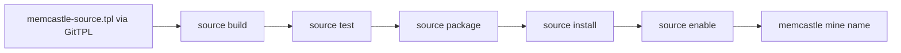
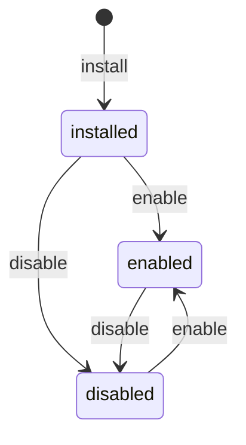

# Writing a mining source

For a new provider plugin, invoke [`memcastle-source.tpl`](plugins.md) directly through GitTPL and compose the module
into the provider's parent template.
The same source template can render a standalone module for the legacy source-package workflow.

A mining source finds documents in some origin (a chat export, an issue tracker, an agent's session files),
reads them, and puts them in MemCastle's terms.
MemCastle does everything else: chunking, deduplication, drawers, the cursor and the durable job
([Mining sources](mining-sources.md) describes that pipeline).

There are two kinds of source behind one contract.
A **built-in** source is Rust compiled into MemCastle (`directory`).
An **installed** source is a WebAssembly component the user installs, written in any language that produces one.
Both implement the same adapter contract and are held to the same conformance cases,
so the pipeline cannot tell them apart ([ADR-026](adr/026-pluggable-source-adapters-as-webassembly-components.md)).



## Quick start

```sh
git tpl init https://github.com/memcastle/memcastle-source.tpl my-notes --init \
  --answer module_name=my-notes --defaults --strict-answers --trust
cd my-notes
memcastle source build        # dist/source.wasm
memcastle source test         # the conformance cases, in the daemon's own sandbox
memcastle source package      # dist/my-notes-0.1.0.tar.gz

memcastle source install dist/my-notes-0.1.0.tar.gz --enable
memcastle mine my-notes ~/notes
```

GitTPL and `build`, `test`, `package`, `index` and `keygen` are local: they need no daemon and no palace.
`install` and the commands after it talk to the daemon.

## What a source implements

The contract is `wit/memcastle-source.wit`, and the same six functions as the native `SourceAdapter` trait.
Everything crossing the boundary is plain data; cursors and metadata are JSON text.

| Function | Contract |
|---|---|
| `identify(locator, options)` | Validate the locator (or choose the source's default when absent) and the run's options, and return the source's identity carrying the options as normalised. Two spellings of the same place must give the same identity, because the identity is what carries the cursor. An option the source does not declare is an `invalid-input` error, never ignored. See [Options](#options). |
| `default-wing(source)` | The wing drawers are filed under when the caller names none. |
| `default-room()` | The room drawers are filed under when a document names none. |
| `discover(source, cursor, limit)` | Candidates strictly after `cursor` (JSON; `null` is the beginning), in cursor order, at most `limit`, each with the cursor to store once it is done; and whether anything is left. A listing, not a download. |
| `read(source, candidate)` | One raw document with a **revision** that changes exactly when the content does, or none to skip it (gone, binary, too large). Skipping is not an error. |
| `normalize(raw)` | The canonical document: title, room, kind, tags, and the content as ordered segments. Pure: the host runs it with no permissions at all. |

A source does not chunk, deduplicate, name drawers' ids, store a cursor or know about jobs.
A cursor is the source's own JSON; a cursor it did not produce is reported as `cursor-invalid`, and MemCastle tells the
user to mine with `--full`.
A cursor is an optimisation, never a correctness mechanism: reading a document twice is always safe.

Three errors cross the boundary: `cursor-invalid`, `invalid-input` (a bad locator) and `failed` (anything that should fail
the job).
A trap, a timeout and an out-of-memory are reported by the host as `memcastle::source::failed` or
`memcastle::source::timeout`.

## The manifest

`memcastle-source.toml` sits at the top of a source project and of a package.
Every table refuses unknown keys.

```toml
format = 1                   # the manifest format; optional, and 1 is the only one so far

[source]
name = "my-notes"            # the name given to `memcastle mine`: lowercase letters, digits, "-"
version = "0.1.0"            # semantic version of the package
description = "my notes"     # one line, shown by `memcastle sources`
license = "MIT"              # optional: SPDX identifier, shown by `memcastle source search`
homepage = "https://example.org/my-notes"        # optional
repository = "https://example.org/my-notes.git"  # optional: where the code is

[compatibility]
contract = "0.4"             # the WIT contract version it was built against
memcastle = ">=0.4.0, <0.5.0"  # this release line; change it when targeting another release

[capabilities]               # the same three as a built-in adapter; all default to false
incremental = true
retains_raw = false
needs_credentials = false   # true when credentials are required; see the OAuth rule below

[permissions.filesystem]
read = ["locator"]           # "locator", an absolute directory, or "~/..."

[permissions]
network = false              # all or nothing
process = []                 # bare program names the source may run
env = []                     # environment variables the source may read
credential = false           # opt in to the selected env/file credential, required or optional

# Only for a source that signs in with OAuth; see "Signing in with OAuth". needs_credentials must then be true.
# [permissions.oauth]
# client_id = "my-public-client-id"
# scopes = ["read"]
# token_url = "https://auth.example.com/oauth/token"
# device_authorization_url = "https://auth.example.com/oauth/device/code"   # the device flow
# authorize_url = "https://auth.example.com/oauth/authorize"                # the browser flow, with PKCE
# callback_path = "/auth/callback"   # optional registered loopback path, defaults to /callback
# on_demand = true                  # optional: only online calls need a sign-in; offline calls can still run

[options.since]              # optional: what `memcastle mine my-notes key=value` accepts; see "Options"
type = "date"                # "string" (the default), "path" or "date"
description = "only files modified at or after this date"

[triggers.watch]             # optional: what can trigger a run beyond a timetable and a poll; see "Triggers"
description = "a file under the directory is created or changed"

[limits]
memory_mib = 64              # at most mining.source_memory_mib
timeout_secs = 30            # per call; at most mining.source_timeout_secs

[build]                      # development only; the daemon never runs it
command = ["cargo", "build", "--release", "--target", "wasm32-wasip2", "--target-dir", "target"]
output = "target/wasm32-wasip2/release/my_notes.wasm"

[test]                       # development only
fixtures = "fixtures"
```

| Key | Rule |
|---|---|
| `format` | A whole number, 1 or more. A format newer than this MemCastle reads is `incompatible`, with a message to upgrade. |
| `source.name` | 1 to 48 lowercase letters, digits or `-`, not starting or ending with `-`. Not a built-in name. |
| `compatibility.contract` | `MAJOR.MINOR` or `MAJOR.MINOR.PATCH`. |
| `compatibility.memcastle` | A semver requirement. A pre-release of a release is held to the release's requirement. |
| `permissions.filesystem.read` | `locator`, an absolute path, or a path starting with `~/`. A directory that does not exist is dropped, not an error. |
| `options.<name>` | A key of lowercase letters, digits, `-` or `_` starting with a letter, with a one-line `description` and a `type` of `string`, `path` or `date`, and optional `breadth` (`include`, `opt_in_include`, `exclude` or `since`). Options are not permissions: they ask for nothing and are no part of what a user consents to. |
| `triggers.<kind>` | `webhook` or `watch` (a timetable and a poll are every source's, so they are not declared), with a one-line `description`. A capability, not a permission: nothing starts because it is declared, and it is no part of what a user consents to. |
| `permissions.process` | Bare program names (`git`), never a path or a command line. |
| `permissions.credential` | `true` grants access to a selected env/file reference, not every daemon credential. With `capabilities.needs_credentials = false`, mining without a selection is allowed; with `true`, a selected env/file credential is required. |
| `permissions.oauth` | `client_id` and `token_url`, and `device_authorization_url`, `authorize_url` or both; every URL `https` (plain `http` only to `localhost`); each scope one word; and `capabilities.needs_credentials = true`. A declared `callback_path` replaces `/callback` on the same loopback listener; `on_demand = true` lets an offline mode proceed without a sign-in while the online mode must ask for its token at `identify`. No client secret: a public client cannot keep one. |
| `build.output` | Relative to the project; it must be a component, not a core module. |

An OAuth source that cannot select more than one web account declares `single_account_auth = true` under `[capabilities]`.
The daemon then refuses named web sign-ins while permitting offline export configurations with locators.
This capability describes what the source can select; it grants no permission and is not part of the consent digest.

## Options

A user narrows one run of a source with `key=value` words (`memcastle mine my-notes ~/notes since=2026-09`).
A source declares the keys it accepts under `[options.<name>]`,
and the daemon refuses any other key before it queues the job,
naming the accepted ones, so a typo is an error and not a source that mines everything.
`identify` receives them as a list of key and value strings,
validates the values (an invalid one is `invalid-input` with a
message that says what was expected), and returns them on the `source-ref` it gives back,
from which `discover` and `read` read them.
The `type` is for people and for the command line: a `path` value is made absolute against the shell's working directory
before the daemon sees it, since the daemon runs somewhere else.
The optional `breadth` describes how a *change* to this option affects a configured miner.
Use `include` for a comma-separated positive selection where an absent option means everything (fewer values narrow),
`opt_in_include` when absence means none (adding it broadens), `exclude` for exclusions (more values narrow), or `since`
for a chronological lower bound (later dates narrow).
Only declare a rule when the source's implementation proves it; an undeclared rule is conservative and requires
`--allow-broaden` for changed saved options or one-off `miner run` overrides.
These rules do not change the component contract or the permissions a source requests.

An option either narrows or selects, and the two are not the same to the cursor, which belongs to the identity:

- An option that only **narrows** what is read (`since`) must not change the identity.
  A later run with another value continues from the same cursor, and `--full` reads back past it.
- An option that **selects** a different slice of the same place (`dir`,
  within a history that holds many projects) must be folded
  into `account` or `locator` by `identify`, so each slice has a cursor of its own;
  otherwise a run for one slice would move the cursor past documents another slice has not read yet.

The miner's `mapping.wing_from` and `mapping.room_from` use valid string fields in a raw document's JSON metadata;
sources can supply project or grouping names there without choosing a palace destination themselves.
Missing or invalid destination names fall back to the miner's fixed Wing/Room and then to the source defaults.
`mining.max_documents = 0` processes pages until exhausted; `discover` still receives a bounded limit per call.

A case in the conformance fixtures can carry the options of a run in `options`, and runs through the same checks.

## Triggers

A source can say what can trigger a run of it, and that is all.
Every source can be scheduled and polled, because those only mean "mine again", so a source that declares nothing is a
complete source.
`[triggers.watch]` says that a change to local files is a meaningful signal for the source (the user chooses which path
to watch), and `[triggers.webhook]` that a delivery from an external service is (the user sets up the listener and the
secret).
`memcastle sources` and `GET /api/sources` list what each source supports, and a trigger of a kind the source does not
declare is refused when the user tries to enable it.

Declaring a trigger changes nothing else: it adds no WIT function, it is not a permission, it is not part of the consent
digest and it does not change the manifest `format`.
There is also no trigger code in a source.
When a trigger fires, the daemon asks for an ordinary run and the source acquires what is new from its cursor with
`discover` and `read`, so a source for a service with webhooks is one that reads the service on request, and the
user's webhook only says *when*.
Nothing a trigger carries (a delivery's body, the path that changed) reaches the source.
See [Triggers](triggers.md).

## Permissions and consent

A source starts with nothing: no filesystem, no environment, no network, no programs.
The manifest lists what it asks for and nothing else is granted.

| Permission | What the host does |
|---|---|
| `filesystem.read` | Opens the listed directories read-only, at the same path inside the sandbox as outside it, so `std::fs` on the locator works unchanged. `locator` is canonicalised by the host; when it names a file, its parent directory is opened because WASI preopens directories. There is no write access. |
| `network` | Opens the network, all or nothing. The host cannot yet restrict by host name, and the consent prompt says so. |
| `process` | Lets the source call `run-process` for exactly those programs: no shell, a minimal environment (`PATH`, `HOME`, and the variables in `env`), a time limit, a cap on output (16 MiB, enforced while the program runs; its output is captured through scratch files, so a program that drops output on a pipe still answers whole). Any other program is refused. |
| `env` | Passes the listed variables, when set, into the sandbox. It sees no others. |
| `credential` | Allows `host.source-credential()` to return the job's selected env/file credential during acquisition. Neither its variable name nor file path needs an `env`/`filesystem` grant. It is never inherited by `run-process` unless the variable is separately listed under `env`. |
| `oauth` | Lets the source call `access-token` for the sign-in the manifest declares (see below). The consent prompt says "sign in with OAuth at *host*" with the scopes, and a credential is never used under terms other than the ones agreed to. |

`normalize` runs with none of these, whatever the manifest says.
`default-wing` and `default-room` also receive no credential.
When a selected credential references `PATH`, `HOME` or `SystemRoot`, the host omits that variable from a child process's
normally inherited environment unless the manifest separately lists it under `env`.

Installing a package that asks for anything needs the user's consent to exactly those permissions.
`memcastle source install` prints them and asks;
the daemon recomputes a digest of the name and the normalized permissions and refuses an install that does not carry it,
so consent for one source or one set of permissions is not consent for another.
A script is never asked and never consents on its own behalf:
pass `--yes`, or `--consent <digest>` after reviewing the permissions the refusal lists.
A package that asks for nothing needs no consent.

## Selected env and file credentials

A source using operator-managed account tokens declares `credential = true` under `[permissions]`.
Set `needs_credentials = true` under `[capabilities]` when every miner needs a selected env/file reference;
leave it `false` for a source that can also mine public material without one.
An enabled miner without a reference can run the optional source, but `source-credential` returns an error when called
without a selection, so the source must handle that result and use its public mode or a separately consented fallback.
That absent optional selection is not a permission denial: if the source later fails, the daemon reports the later
failure rather than replacing it with the lookup error.
Calling `source-credential` without the manifest's grant is a permission denial, including during `normalize`.
When a miner or its source configuration does select a reference, the daemon still requires it to resolve before the
miner can run.
For example, a source may separately grant `GH_TOKEN` under `permissions.env`; that grant is independent of a job's
selected credential, and the source must handle an unset variable if it supports public mining.
Inside `identify`, `discover` or `read`, a Rust component generated from this WIT can call
`memcastle::source::host::source_credential()` and handle its `Result<String, String>`.
For example, `let token = memcastle::source::host::source_credential().map_err(SourceError::Failed)?;`.
Do not put the token in a `source-ref`, option, cursor, candidate, document, metadata, or error message.
Only the selected source for this job receives it; another installed source needs its own permission and selection.
A source which received a secret is trusted with it: Core cannot stop that component from deliberately emitting it.

The daemon pins the **reference**, not its value, when a mining job is queued.
Each execution (also after a crash, retry, or resume) reads the current value from that same environment variable or
the first line of the same file; an edited configuration cannot switch an already queued job to another account.
The daemon needs a nonempty UTF-8 value, and the file's first line must be at most 64 KiB; failures name the reference
and how to fix it, never its contents.
Set an environment variable before starting the daemon and restart it after changing the variable;
rotating a file's contents does not require a daemon restart.
The job stores only the reference and public job responses omit its name/path and the value.
The selected credential is separate from OAuth `access-token`: a source declaring both permissions can use either
mechanism when its acquisition mode calls for it, but an OAuth selection does not supply an env/file credential.
Older 0.4 components that do not import `source-credential` keep their existing behavior and consent digest.

Each call runs in a fresh sandbox with a memory ceiling (`mining.source_memory_mib`) and a time limit
(`mining.source_timeout_secs`), either of which the manifest can only lower.
A source that loops is stopped by the engine, not by its own good manners.

## Signing in with OAuth

Some origins cannot be reached with a static token.
A source that needs an interactive sign-in, a refresh token, or a credential that renews, declares `[permissions.oauth]`
and asks the host for a token; it does not implement a sign-in, keep tokens, or renew them
([ADR-039](adr/039-oauth-credentials-for-mining-sources.md)).
Signing in is separate from reading the origin:
the manifest says how to sign in, and `discover` and `read` say what to fetch.

```text
memcastle source auth my-source   ->   the daemon runs the flow and keeps the tokens
memcastle mine my-source ->   the daemon renews the token if needed, and hands it to each call that asks
```

The source calls `access-token` (in the `host` interface) and gets a bearer token for the sign-in its manifest declares,
or an error saying why there is none.
Ask on every call that needs one, and do not keep the token between calls: it may have expired since, and the host
renews it, so asking again is how a long run keeps working.
The host refuses the call when the manifest declares no `oauth`, and `normalize`, which runs with no permissions, never
gets a token.
A failure that comes from the credential (never signed in, revoked, the provider unreachable) is reported as
`memcastle::credential::required` or `memcastle::credential::refresh_failed`, whatever the source made of the error it
was given, so return it as a `failed` and let the host say what to do.

What the manifest names is public, so it is a **public client**: a `client_id`, the endpoints, and the scopes, and no
secret.
Which flows the source supports follows from the endpoints it lists:
`device_authorization_url` allows the device flow (RFC 8628), which works on a machine with no browser and which the
command prefers when it is available, and `authorize_url` allows the authorization code flow with PKCE (RFC 7636).
Changing the client, an endpoint or the scopes in an update asks for consent again, and a credential obtained under the
old terms is treated as missing, so an update never widens what a stored sign-in may do.

Signing in needs no `network` permission, because the host talks to the provider.
Calling the origin's API from the source does, and the sandbox does not yet offer an HTTP client of its own, so a source
that fetches from an HTTPS API needs to bring one.

## Lifecycle



| State | Meaning |
|---|---|
| `installed` | In the daemon, not yet enabled: it cannot be mined. |
| `enabled` | Available to `memcastle mine <name>`. |
| `disabled` | Turned off; files and history are kept. |
| `unavailable` | Installed but unable to run here. Never stored: it is computed on every look from the files and the running MemCastle. |

A source is `unavailable` when its component file is missing, when it no longer matches the digest recorded at install
(so a file swapped on disk is never run), or when its contract or MemCastle requirement is not met.
`memcastle source list` says why, and installing the package again repairs a missing or altered one.
Enabling and disabling are idempotent, and an unavailable source cannot be enabled.
Installing a name that is already installed replaces it and keeps its state.
Removing a source deletes its files and its record, and keeps what it mined.
Built-in sources are always enabled and cannot be disabled or removed.

## Compatibility

The contract has a version (`wit/memcastle-source.wit`, currently `0.4.0`), and a source declares the one it was built
against.

| Host contract | A source built for it runs on |
|---|---|
| `0.N` (before `1.0`) | A host implementing exactly `0.N`. Any minor version may break the contract. |
| `M.N` (`M` at least 1) | A host of the same major `M` whose minor is at least the source's. |

A patch version is documentation only.
A new contract version makes every installed source of the old one `unavailable` with a reason that says to rebuild,
rather than failing at the first mine.
Use a revision of `memcastle-source.tpl` whose contract matches the MemCastle release you target.

## Templates and their toolchains

The maintained GitTPL source template is Rust/Wasm.
The other implementations below describe existing legacy source projects and their toolchains; GitTPL does not generate
those variants.

| Template | Written in | Toolchain | Notes |
|---|---|---|---|
| `rust` | Rust | `rustup target add wasm32-wasip2` | Compiles straight to a component. Smallest and fastest to start. |
| `cli` | Rust | The same | Wraps a command-line program through `run-process`; the manifest lists the programs. For a source that is easiest written as a script or an existing tool. |
| `typescript` | TypeScript | Node.js, `npm install` (`jco`, `typescript`) | Compiled to JavaScript, then componentized with `jco`, which embeds a JavaScript engine: the component is megabytes and slower to start. |
| `python` | Python | `pip install componentize-py` | Componentized with `componentize-py`, which embeds CPython: only the standard library and pure-Python packages bundled with it are available. |

TypeScript and Python are not compiled directly to WebAssembly, and these templates are provided as starting points:
their toolchains are not installed in MemCastle's CI, so the suite checks that they scaffold a valid project but does not
build them.
Rust and `cli` sources are built and run for real by the test suite.

## Conformance

`memcastle source test` runs the cases listed in the manifest's `[test] fixtures` against the built component, loaded the
way the daemon loads it.
A case is a directory holding `case.json` and a tree; the runner is generic over the adapter contract, so MemCastle runs
the same cases against its native `directory` source and against the reference component.

| Check | What a source must do |
|---|---|
| Identity | `identify` returns the source's own name, and the same identity for the same locator. |
| Paging | Each page has at most `limit` candidates, no candidate repeats, and resuming from a page's last cursor starts strictly after it. |
| Foreign cursor | A cursor the source did not produce is refused as `cursor-invalid`. |
| Incremental | After the last cursor, an incremental source finds nothing and says it is exhausted. |
| Revision | Reading a document twice gives the same revision. |
| Normalization | Normalizing twice gives the same document, with the title, kind, tags, room and segments the case expects. |
| Skips | What the case lists as skipped produces no document. |

A case is described by:

| Field | Meaning |
|---|---|
| `name`, `description` | What it checks. |
| `locator`, `limit` | The tree, relative to the case, and the page size (smaller than the number of documents, so paging happens). |
| `options` | The options of the run, when the case is about one (`{"dir": "/home/me/project"}`). |
| `documents` | The external ids that must be produced, each with its normalized `title`, `kind`, `tags`, `room` and `segments`. |
| `skipped` | Paths in the tree that must produce no document. |

What differs legitimately between sources (the shape of a cursor, a revision's format, a drawer name) is not compared.

The cases shipped with MemCastle:

| Case | What it covers |
|---|---|
| `text-tree` | Text files in nested directories, with hidden and build directories, a binary file and an empty one; paged by two. |

## Packaging and distribution

`memcastle source package` builds the component (unless `--no-build`) and writes `dist/<name>-<version>.tar.gz`:
`memcastle-source.toml`, `source.wasm`, and the project's `README.md` and `LICENSE` when present.
The archive is deterministic, so packaging the same source twice gives the same bytes and its digest can be published.
Only those top-level files are ever read from an archive.
It reads the package back before reporting success, so a package that would not install is found where it is made.

`memcastle source install` puts the component under `mining.sources_dir` and records the manifest the user agreed to
and the component's SHA-256 in the palace, with where it came from.
Installed sources belong to one daemon: with a shared remote palace, each daemon needs the package installed, and one
that lacks the files reports the source `unavailable`.

The package is the whole of what a user needs: nobody installing a published source needs Rust, Python, Node or an SDK.
Publishing one, finding one by name, updating it, signing it and trusting a publisher are in
[Publishing and installing sources](publishing-sources.md).

## Reference sources

`sources/` holds maintained reference sources, one directory each, with the same package layout as any other.
`sources/directory/` is a reference Rust WebAssembly component implementing the same contract as the built-in
`directory` adapter in `src/mining/adapters/directory.rs`, and is the worked example to read when writing a package.
The Pi coding agent's session-history source now lives in
[`memcastle-pi`](https://github.com/memcastle/memcastle-pi) and retains its original `pi` ID.
The [`memcastle-openai`](https://github.com/memcastle/memcastle-openai) plugin owns the `codex` and `chatgpt` sources,
including ChatGPT export ZIP and experimental web imports ([ChatGPT](mining-sources.md#chatgpt)).
The OpenCode coding agent's session-history source lives in
[`memcastle-opencode`](https://github.com/memcastle/memcastle-opencode); it wraps `run-process` and is tested against a
stand-in for the agent's CLI ([OpenCode](mining-sources.md#opencode)).
The GitHub repository source lives in [`memcastle-github`](https://github.com/memcastle/memcastle-github) and retains
its original `github` ID.
Core currently bundles no WebAssembly sources; `sources/directory/` remains as the reference implementation of the
same package contract that provider plugins use.

## Testing your source in CI

`memcastle source test` needs no daemon and builds the component first, so it is all a CI job has to run.
In a project of your own, install the `wasm32-wasip2` target (or your template's toolchain), build `memcastle`,
and run `memcastle source test .`.
In this repository Core CI explicitly runs `mise run sources:test -- directory` for the maintained reference source.
Adding another reference source to CI requires an entry in the `sources` matrix in `.github/workflows/ci.yaml`.

## Troubleshooting

| Code | Cause |
|---|---|
| `memcastle::source::manifest_invalid` | `memcastle-source.toml` does not parse or breaks a rule above. |
| `memcastle::source::package_invalid` | The archive is not readable, or lacks the manifest or the component. |
| `memcastle::source::incompatible` | The contract or MemCastle version does not match, or the component does not fit the contract. Rebuild it. |
| `memcastle::source::consent_required` | The package asks for permissions that were not agreed to. Review them and pass `--yes` or `--consent`. |
| `memcastle::source::not_found` | No installed source has that name. |
| `memcastle::source::not_enabled` | The source is installed but disabled, or unavailable; `memcastle source list` says which. |
| `memcastle::source::builtin` | Built-in sources cannot be disabled, replaced or removed. |
| `memcastle::source::failed` | The source ran and failed, trapped or ran out of memory. The message is the source's own. |
| `memcastle::source::timeout` | One call took longer than its limit. |
| `memcastle::source::cursor_invalid` | The stored cursor is not one the source produced. Mine again with `--full`: unchanged documents are skipped. |
| `memcastle::source::permission_denied` | The source ran a program its manifest does not list, or asked for an access token without declaring `[permissions.oauth]`. |
| `memcastle::source::build_failed` | The build command failed or did not produce a component. |
| `memcastle::source::registry_unavailable` | A registry's index could not be read: unreachable, not an index, or a format this MemCastle does not know. Check `mining.registries`. |
| `memcastle::source::not_in_registry` | No registry offers that name, or none of its versions can be installed here. `memcastle source search` lists what is offered. |
| `memcastle::source::bundled` | A source that ships with MemCastle cannot be installed from a registry, updated or removed: it is installed already, and `source enable` or `disable` is all it takes. |
| `memcastle::source::integrity` | A downloaded package is not the archive the index published: its SHA-256 differs, or the package inside is not the name and version listed. Nothing was installed. |
| `memcastle::source::untrusted` | The trust policy refuses the package: a bad signature from a trusted key, or no trusted signature under `mining.trust = "required"`. |
| `memcastle::source::signing_failed` | A signing key or signature could not be made or read. `memcastle source keygen` writes a new key. |
| `memcastle::credential::required` | The source signs in with OAuth and has not been signed in, was signed in under other terms, or the provider revoked it. Run `memcastle source auth <source>`. |
| `memcastle::credential::refresh_failed` | The stored credential could not be renewed just now, usually the provider or the network. It is kept, so run again later. |
| `memcastle::credential::flow_failed` | A sign-in was declined, expired, or refused by the provider. Run `memcastle source auth <source>` again. |
| `memcastle::credential::oauth_unsupported` | `source auth` was asked for a source that declares no `[permissions.oauth]`. |
| `memcastle::credential::store_failed` | Neither the platform keyring nor the fallback file could be read or written. See [Credentials](configuration.md#credentials). |

A source that cannot read a file it expects usually lacks a `filesystem.read` permission:
the sandbox shows a directory it was not granted as simply not there.
